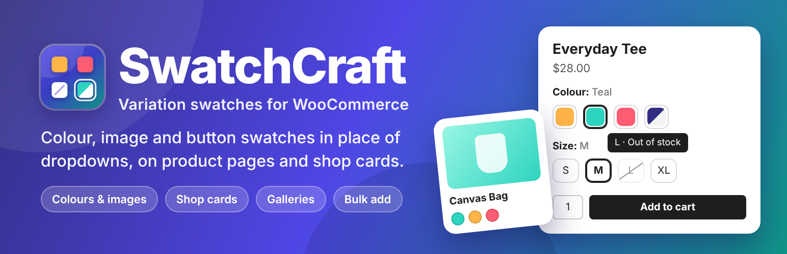
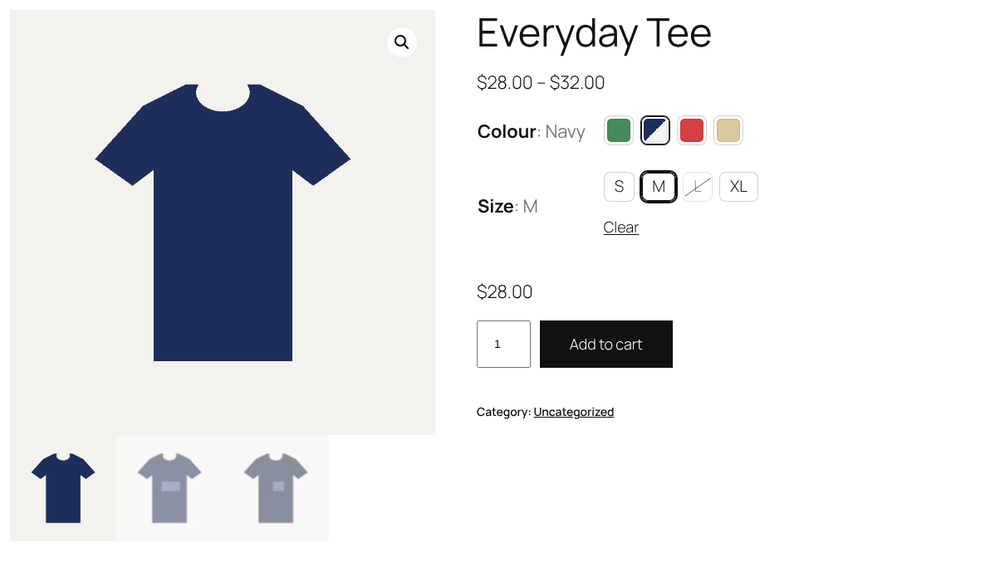
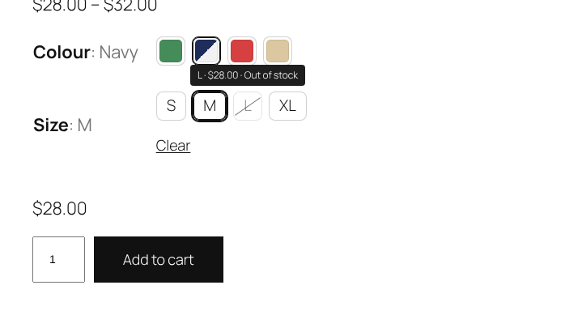
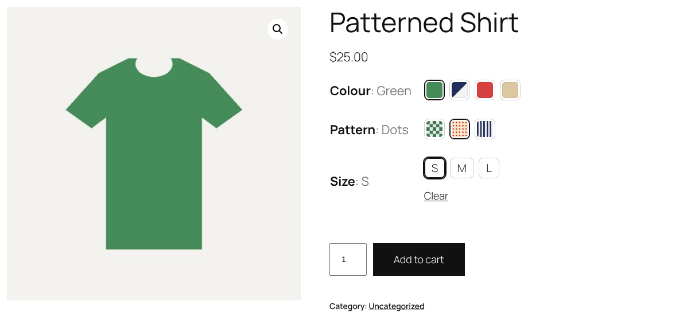
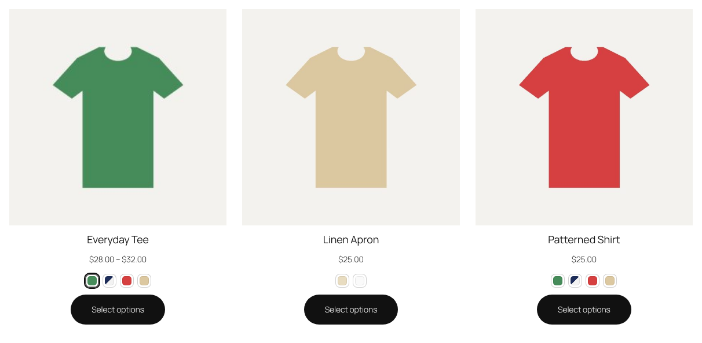
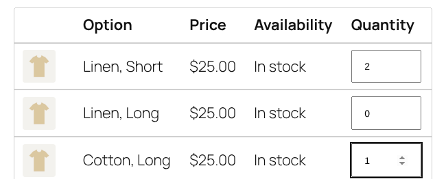
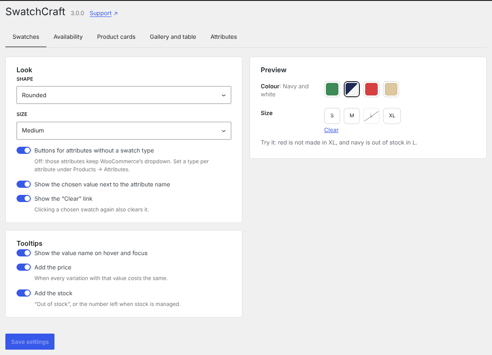
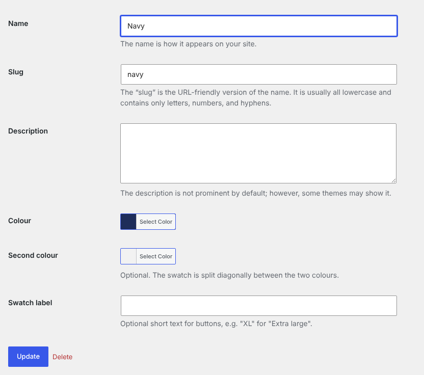
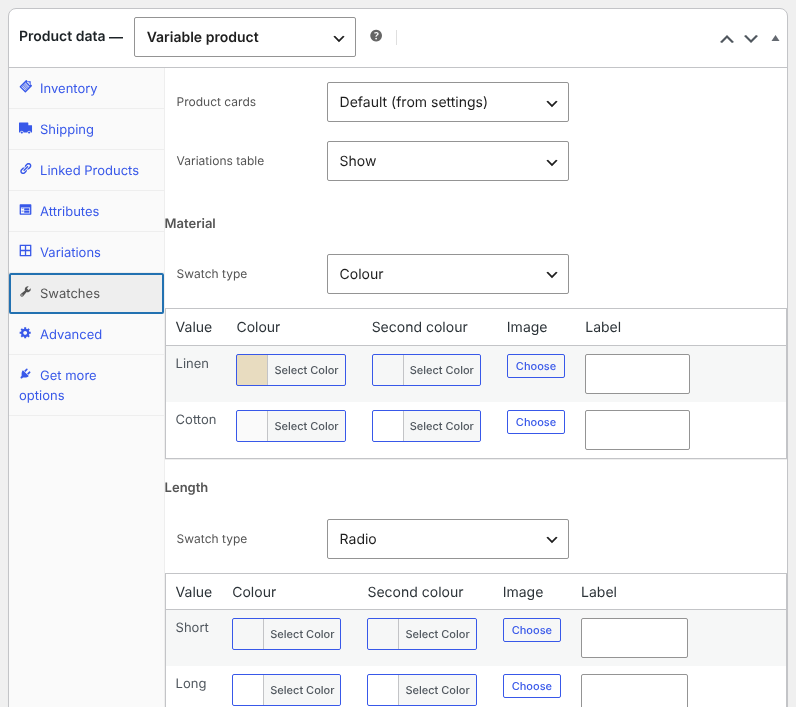

<p align="center">
  <a href="https://wordpress.org/plugins/wp-smart-variations/"></a>
</p>

<h1>
  
  SwatchCraft – Variation Swatches for WooCommerce
</h1>

[](https://wordpress.org/plugins/wp-smart-variations/)
[](https://wordpress.org/plugins/wp-smart-variations/)
[](https://wordpress.org/plugins/wp-smart-variations/)
[](https://wordpress.org/plugins/wp-smart-variations/)
[](https://github.com/rajanvijayan/wp-smart-variations/actions/workflows/ci.yml)
[](https://www.gnu.org/licenses/gpl-2.0.html)

Colour, image and button swatches for WooCommerce variations, on product pages and shop cards, with variation image galleries and a variations table for bulk add to cart. SwatchCraft is the new name and rewrite of **WP Smart Variations**: the plugin slug is still `wp-smart-variations`. Everything is free.

**[Download on WordPress.org](https://wordpress.org/plugins/wp-smart-variations/)** · [Changelog](readme.txt) · [Roadmap](docs/ROADMAP-3.0.md)

## Screenshots

| Product page | Out of stock and unavailable |
|---|---|
| [](.wordpress-org/screenshot-1.png) | [](.wordpress-org/screenshot-2.png) |
| **Image swatches** | **Shop cards** |
| [](.wordpress-org/screenshot-3.png) | [](.wordpress-org/screenshot-4.png) |
| **Variations table** | **Settings** |
| [](.wordpress-org/screenshot-5.png) | [](.wordpress-org/screenshot-6.png) |
| **Attribute terms** | **Product Swatches tab** |
| [](.wordpress-org/screenshot-7.png) | [](.wordpress-org/screenshot-8.png) |

## Features

### 🎨 Swatches
- **Colour** (one colour, or two split diagonally), **image**, **button** (value name or a short label) and **radio** swatches, or WooCommerce's **dropdown**.
- The type is set on each global attribute (Products → Attributes), colours and images on its terms, with **per-product overrides** in a Swatches tab; custom attributes of one product can have swatches too.
- **Automatic buttons** for attributes without a type, so every variable product gets swatches without setup.
- Uses WooCommerce's own colour and image term fields when they are filled in.

### 🛍️ On the product page
- **Unavailable** combinations crossed out or hidden; **out-of-stock** values crossed out, clickable or hidden.
- The chosen value next to the attribute name, tooltips with the value name and optionally its price and stock, and a Clear link.
- WooCommerce's hidden `<select>` still drives the form, so prices, stock, images, add to cart and other plugins keep working.
- Radio-group semantics with arrow keys; dropdowns stay when JavaScript is off.
- Products over the AJAX threshold (variations loaded one at a time) are supported.

### ✨ Extras
- **Product card swatches** (classic shop templates and the Product Collection block): image swap and a link to the product with the value preselected, a "+N more" limit, above or below the button.
- **Variation image galleries**, shown in the product gallery when the variation is chosen.
- **Variations table** with bulk add to cart:

  | Where | |
  |---|---|
  | Product pages | Below the add-to-cart form, instead of it, or only on products that turn it on |
  | Block | Variations Table (`swatchcraft/variations-table`) |
  | Shortcode | `[swatchcraft_table id="123"]` |

  Without JavaScript the table posts a normal form.

### ⚙️ Settings
- WooCommerce → SwatchCraft, with a live preview: shape (round, rounded, square), size, automatic buttons, unavailable and out-of-stock behaviour, tooltips, product cards, galleries and the table.
- Themes can restyle the swatches with `--swatchcraft-size`, `--swatchcraft-radius`, `--swatchcraft-gap`, `--swatchcraft-border`, `--swatchcraft-active` and `--swatchcraft-surface`.
- Compatible with WooCommerce order storage (HPOS) and the cart and checkout blocks.

### Upgrading from 1.0
Version 1.0 turned WP eCommerce variation dropdowns into radio buttons. Sites that still run WP eCommerce keep that behaviour, now from an enqueued script. 1.0 stored no data.

## Requirements

WordPress 6.5, PHP 7.4 and WooCommerce 9.0 or later.

## Development

```
composer install
npm ci && npm run build
composer lint                      # PHPCS (WordPress Coding Standards)
npm run lint:js && npm run lint:css
bin/install-wp-tests.sh wordpress_test root root 127.0.0.1 latest
# The tests run against WooCommerce: point WC_DIR at a WooCommerce plugin folder.
WP_TESTS_DIR=/tmp/wordpress-tests-lib WC_DIR=/path/to/woocommerce vendor/bin/phpunit
```

`vendor/` and `build/` are not committed. Releases are deployed to WordPress.org by GitHub Actions; see [`RELEASING.md`](RELEASING.md).

### Layout

| Path | |
|---|---|
| `install.php` | Plugin bootstrap (the file name is kept from 1.0) |
| `src/data/` | Swatch types, colours, images and labels of attributes, terms and products |
| `src/admin/` | Attribute and term fields, the product Swatches tab and the settings page |
| `src/front/` | Swatches, product cards, galleries, variations table and assets |
| `src/rest/` | REST controllers |
| `src/legacy/` | WP eCommerce radio buttons from 1.0 |
| `assets/src/` | Front-end, admin, settings and block editor scripts and styles |
| `blocks/` | Block metadata |

### REST API (`swatchcraft/v1`)

| Route | Methods | |
|---|---|---|
| `/cart` | POST | Add several variations to the cart: `{ product_id, items: { variation_id: quantity } }`. Needs the REST nonce. |
| `/settings` | GET, POST | Read and save settings (shop managers) |

### Hooks

| Hook | |
|---|---|
| `swatchcraft_attribute_type` (filter) | Swatch type of an attribute on a product |
| `swatchcraft_attribute_options` (filter) | Values of an attribute with their names, labels, colours and images |
| `swatchcraft_loaded` (action) | SwatchCraft has loaded with WooCommerce |

## License

GPL-2.0-or-later.
